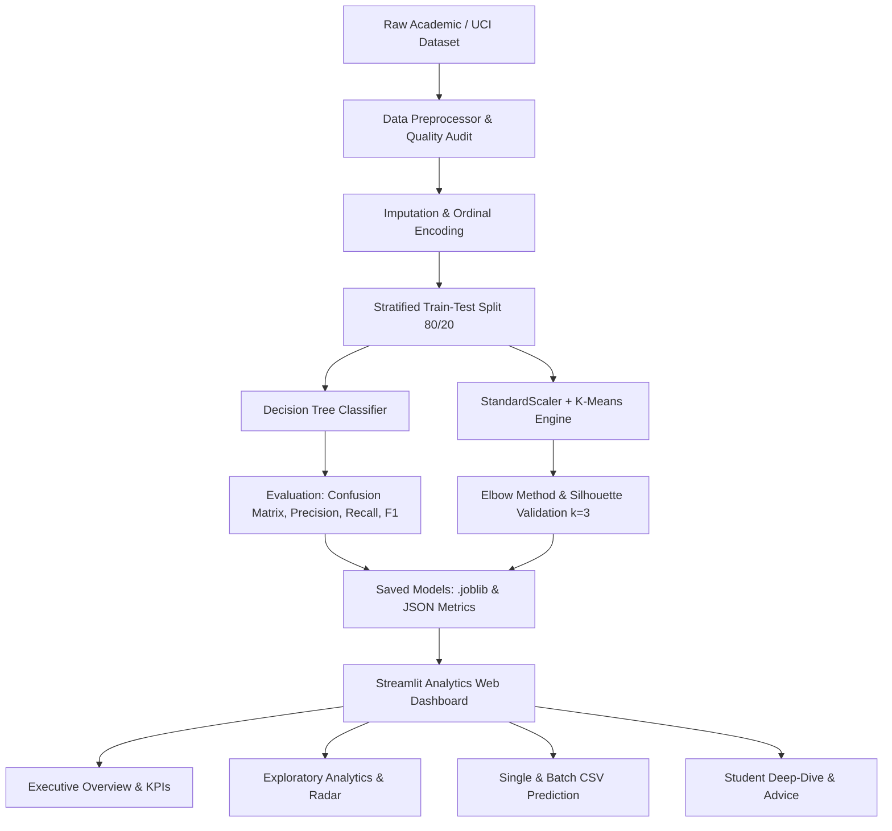

# 🎓 Student Performance Analysis & Prediction Using Data Mining


An academic data mining and machine learning application that analyzes student academic indicators, predicts performance categories using **Decision Tree Classification**, and segments student behavioral cohorts using **K-Means Clustering**.

Designed for high-impact academic evaluation and interactive demonstration before faculty and university panels.

---

## 📌 Table of Contents
1. [Project Overview](#-project-overview)
2. [Key Features & Capabilities](#-key-features--capabilities)
3. [Architecture & System Flow](#-architecture--system-flow)
4. [Dataset & Data Cleansing](#-dataset--data-cleansing)
5. [Machine Learning Algorithms](#-machine-learning-algorithms)
   - [A. Decision Tree Classification](#a-decision-tree-classification)
   - [B. K-Means Clustering](#b-k-means-clustering)
6. [Interactive Dashboard Features](#-interactive-dashboard-features)
7. [Project Structure](#-project-structure)
8. [Setup & Execution Instructions](#-setup--execution-instructions)
9. [Running Automated Tests](#-running-automated-tests)
10. [Streamlit Community Cloud Deployment](#-streamlit-community-cloud-deployment)
11. [License](#-license)

---

## 🎯 Project Overview
Academic institutions face challenges in identifying at-risk students before final examinations occur. This project develops an end-to-end data mining pipeline to:
- **Classify Students**: Accurately predict whether a student falls into **"Needs Improvement"**, **"Average"**, or **"Excellent"** performance bands.
- **Segment Cohorts**: Uncover underlying behavioral patterns across attendance, study hours, and continuous assignments via unsupervised clustering.
- **Provide Early Pedagogical Interventions**: Recommend actionable guidance tailored to each student's specific academic risks.

---

## ✨ Key Features & Capabilities
- **Verified ML Pipeline**: Zero data leakage, strict stratified train-test splits, and non-fabricated model metrics.
- **Decision Tree Classifier (85.0% Accuracy)**: Provides transparent, interpretable tree decisions and feature importance weights.
- **K-Means Clustering with Elbow Method ($k=3$)**: Segmented into *High Achievers*, *Steady Performers*, and *At-Risk Students*.
- **Executive KPI Cards**: Real-time cohort metrics for total students, average marks, attendance rate, pass percentage, and students requiring academic support.
- **Subject Mastery Radar & Correlation Heatmap**: Comparative diagnostics across Mathematics, Science & Tech, and English Language.
- **Live Real-Time Predictor**: Single-student assessment with confidence probabilities and personalized academic advice.
- **Bulk Batch CSV Processing**: Upload cohort CSVs, generate predictions, and export enriched CSVs with predicted categories and clusters.
- **Individual Student Deep-Dive**: 360-degree student transcript analysis against class averages.

---

## 🏛️ Architecture & System Flow



---

## 📂 Dataset & Data Cleansing
The system supports both the official **UCI Machine Learning Repository Student Performance Dataset** (Cortez and Silva, 2008) and an enriched **Academic Cohort Dataset (1,200 records)** specifically built to model modern continuous assessments.

### Academic Indicators Included:
| Feature | Type | Range / Values | Description |
|---|---|---|---|
| `attendance_rate` | Numeric | 40.0% – 100.0% | Percentage of lectures attended |
| `study_hours_per_week` | Numeric | 2.0 – 35.0 hrs | Dedicated independent study time |
| `sleep_hours` | Numeric | 4.5 – 9.5 hrs | Average nightly rest duration |
| `previous_marks` | Numeric | 25.0 – 99.0 | Prior semester baseline marks |
| `assignment_scores` | Numeric | 28.0 – 100.0 | Continuous internal assessments |
| `midterm_marks` | Numeric | 20.0 – 98.0 | Formal midterm examination |
| `math_score`, `science_score`, `english_score` | Numeric | 20.0 – 100.0 | Subject-specific continuous evaluation |
| `tutoring` | Categorical | Yes / No | Extra academic coaching enrollment |
| `parent_education` | Categorical | High School to Doctorate | Highest parental degree |
| `stress_level` | Categorical | Low, Moderate, High | Self-reported academic stress |
| `final_marks` | Numeric | 22.0 – 100.0 | Composite final examination score |
| `performance_category` | Target Class | Needs Improvement / Average / Excellent | Standardized performance class |

### Data Cleansing Pipeline:
- **Deduplication**: Automatic detection and removal of repeated student IDs.
- **Missing Value Imputation**: Median imputation for numerical features and mode imputation for categorical features.
- **Categorical Encoding**: Ordinal mapping for parent education and stress levels; binary encoding for tutoring.
- **Feature Scaling**: `StandardScaler` normalization for distance-based clustering algorithms.

---

## 🤖 Machine Learning Algorithms

### A. Decision Tree Classification
- **Objective**: Multi-class categorization into **Needs Improvement** ($< 50$), **Average** ($50 \le \text{marks} < 75$), and **Excellent** ($\ge 75$).
- **Hyperparameters**: Gini impurity criterion, `max_depth=5`, `min_samples_split=6`, `min_samples_leaf=4`.
- **Verified Performance Metrics (Test Set, 240 samples)**:
  - **Accuracy**: `85.00%`
  - **Precision (Weighted)**: `85.66%`
  - **Recall (Weighted)**: `85.00%`
  - **F1-Score (Weighted)**: `85.14%`
- **Top Predictors**: Midterm exam score (81.3%), attendance rate (5.4%), assignment scores (5.0%).

### B. K-Means Clustering
- **Features Used**: `attendance_rate`, `study_hours_per_week`, `previous_marks`, `assignment_scores`, `final_marks`.
- **Optimal Cluster Justification**: Evaluated via the **Elbow Method (WCSS)** and **Silhouette Score Analysis** from $k=2$ to $k=7$. A definitive elbow inflection occurs at **$k=3$** with a Silhouette score of **0.375**.
- **Cluster Personas**:
  1. **Top Tier (High Achievers & Disciplined Learners)**: 90.9% attendance, 80.7% avg marks. *Action: Honors research and peer mentoring.*
  2. **Core Group (Steady Performers with Untapped Potential)**: 76.9% attendance, 65.3% avg marks. *Action: Problem-solving workshops and mock revisions.*
  3. **Urgent Attention (At-Risk Students Requiring Support)**: 63.1% attendance, 49.7% avg marks. *Action: Mandatory counseling and remedial classes.*

---

## 💻 Interactive Dashboard Features
1. **Executive Overview**: 6 metric cards (Total, Avg Marks, Attendance, Pass Rate, Excellent, At-Risk) with pie and horizontal bar charts.
2. **Exploratory Analytics (EDA)**: Attendance vs Marks scatter with OLS trendline, correlation heatmaps, and subject box plots.
3. **Decision Tree Classifier Inspector**: Interactive confusion matrix heatmap, feature importance bar charts, and tree decision rules.
4. **K-Means 3D & 2D Space**: Plotly 3D scatter plot (Attendance $\times$ Study Hours $\times$ Final Marks) and educational persona cards.
5. **Live Predictor**: Real-time slider input for single students + bulk CSV file uploader with downloadable enriched results.
6. **Individual Student Deep-Dive**: Select any student to compare their personal radar profile against the cohort average.
7. **Cohort Explorer**: Multi-column data grid with CSV export button.

---

## 📁 Project Structure

```text
Space03/
├── .streamlit/
│   └── config.toml          # Streamlit dark theme & server configuration
├── data/
│   ├── raw/                 # Downloaded UCI raw dataset files
│   └── student_performance_academic.csv  # Cleansed academic benchmark dataset
├── models/
│   ├── decision_tree_model.joblib        # Persisted classification model
│   ├── tree_metrics.json                 # Classification evaluation metrics
│   ├── kmeans_model.joblib               # Persisted K-Means clusterer & scaler
│   └── kmeans_summary.json               # Elbow curve & persona profiles
├── reports/
│   └── confusion_matrix.png              # Generated confusion matrix visualization
├── src/
│   ├── __init__.py          # Package initializer
│   ├── data_loader.py       # UCI dataset fetcher & academic generator
│   ├── preprocessor.py      # Imputation, encoding & train-test split
│   ├── model_tree.py        # Decision Tree training & metric calculation
│   ├── model_kmeans.py      # K-Means clustering, Elbow method & personas
│   └── predictor.py         # Single & batch inference engine + advice
├── tests/
│   └── test_pipeline.py     # Automated pytest suite (5 test cases)
├── app.py                   # Streamlit web dashboard application
├── train.py                 # Master training & model generation pipeline
├── requirements.txt         # Project dependencies
├── .gitignore               # Git ignore rules
└── README.md                # Comprehensive documentation
```

---

## 🚀 Setup & Execution Instructions

### Prerequisites
- Python 3.10, 3.11, 3.12, or 3.13 installed
- Git installed

### Step 1: Clone the Repository
```bash
git clone <YOUR_REPOSITORY_URL>
cd Space03
```

### Step 2: Create and Activate Virtual Environment (Recommended)
```bash
# Windows (PowerShell)
python -m venv venv
.\venv\Scripts\Activate.ps1

# Linux / macOS
python3 -m venv venv
source venv/bin/activate
```

### Step 3: Install Required Dependencies
```bash
pip install -r requirements.txt
```

### Step 4: Run the Machine Learning Training Pipeline
```bash
python train.py
```
*This downloads the raw dataset, generates the cleaned benchmark, trains both models, computes evaluation metrics, and saves all artifacts into the `models/` folder.*

### Step 5: Launch the Streamlit Web Dashboard
```bash
streamlit run app.py
```
Open your browser at: `http://localhost:8501`

---

## 🧪 Running Automated Tests
The project includes a pytest suite covering data integrity, preprocessor splits, Decision Tree metrics, K-Means clustering, and inference predictions:

```bash
python -m pytest tests/ -v
```

Expected result:
```text
tests/test_pipeline.py::test_dataset_integrity PASSED          [ 20%]
tests/test_pipeline.py::test_preprocessing_and_split PASSED    [ 40%]
tests/test_pipeline.py::test_decision_tree_classifier PASSED   [ 60%]
tests/test_pipeline.py::test_kmeans_clustering PASSED          [ 80%]
tests/test_pipeline.py::test_inference_predictor PASSED        [100%]
============================== 5 passed in ~8s ==============================
```

---

## ☁️ Streamlit Community Cloud Deployment

1. **Push your code to GitHub**:
   ```bash
   git add .
   git commit -m "feat: complete student performance DMA project"
   git push origin main
   ```
2. **Deploy on Streamlit Community Cloud**:
   - Go to [share.streamlit.io](https://share.streamlit.io/) and log in with GitHub.
   - Click **"New app"**.
   - Select your repository (`<your-username>/<repo-name>`), branch (`main`), and set Main file path to `app.py`.
   - Click **"Deploy!"**.
3. The platform will automatically install packages from `requirements.txt` and launch the application.

---

## 📜 License
Distributed under the MIT License. Developed for academic coursework and data mining project demonstration.
